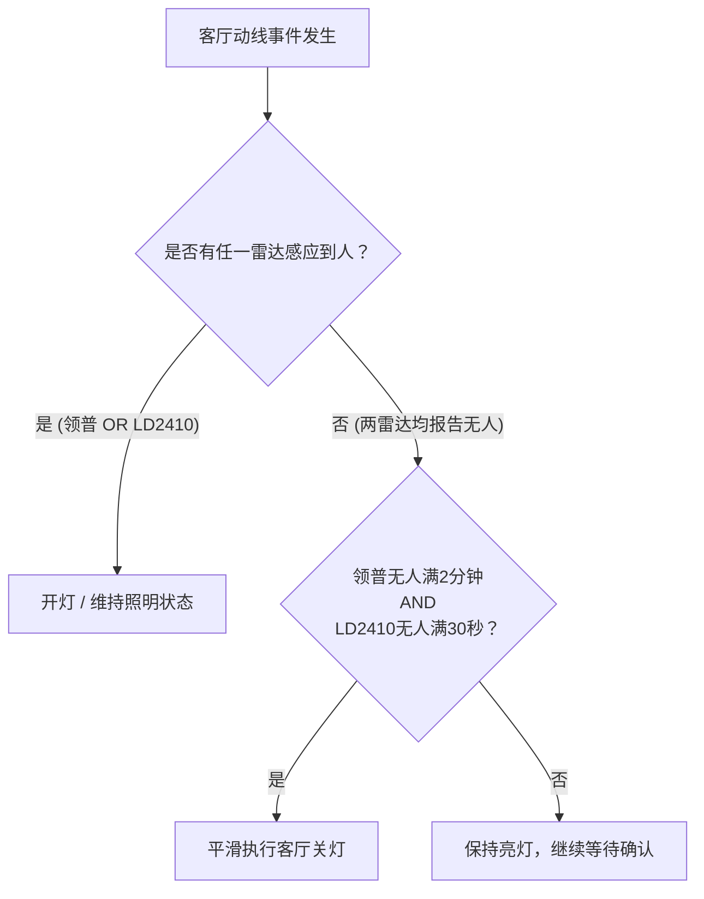

# 全屋人体存在感应拓扑与客厅双雷达布防基准

> 2026-11-09证据校正：本文“正式基准定型”及2.2m高度、固定距离、“零干扰/免疫”等结论未得到对应现场测量支持，不能据此执行。请以[尺寸与感应几何分析](floorplan/2026-11-09-尺寸与感应几何分析.md)区分标注尺寸、条件算例与实测覆盖。


| 项目 | 内容 |
| :--- | :--- |
| **所属系统** | 3038-网关-ha (Home Assistant 全屋智能联动中枢) |
| **户型依据** | `2栋03户型尺寸图-模型.pdf`（AutoCAD 2020 物理实测 CAD 坐标系） |
| **生效日期** | 2026-11-08 |
| **状态** | **正式基准定型** |
| **核心目标** | 彻底根除“客厅坐着被误关灯”与“窗帘微动半夜误开灯”两大顽疾，实现全屋动线毫秒级开灯与沙发静坐永不误关 |

---

## 1. 全屋 9 大人体存在传感器物理拓扑

根据 CAD 图纸与实景核验，全屋人体感知节点划分为三大协同集群：

```
┌─────────────────────────────────────────────────────────────┐
│                     全屋人体存在感应集群架构                    │
└─────────────────────────────────────────────────────────────┘
  │
  ├─► [客餐厅与活动区]
  │     ├─ 客厅领普 (HB01)：沙发后墙 2.2m 高位，居高临下直视走道/舞台（主抓进门开灯）
  │     ├─ 新增 LD2410 (HLK)：电视柜近走道端，正对沙发主座，门限锁死 4.2m（主抓沙发防关灯）
  │     ├─ 厨房领普 (HB01)：橱柜操作台上方，覆盖洗切炒与餐桌过渡区
  │     └─ 阳台感应 (Linp)：阳台主梁上，俯瞰晾晒洗衣区
  │
  ├─► [动线枢纽与全屋中枢区]
  │     ├─ 走道感应：引体向上单杠梁位，覆盖走道正中及三个卧室进出动线
  │     └─ 全屋温湿度中心 & 蓝牙网关 (ESP32-C3 / SHT3x)：走道开关上方（全屋气流汇聚与射频黄金C位）
  │
  └─► [私密休息区]
        ├─ 主人房领普 (HB01)：主卧床头斜角，配合睡眠逻辑
        ├─ 悦烛/悦悦房领普 (HB01)：儿童房书桌/床位感知
        └─ 书房领普 (HB01)：书桌静坐办公与书架活动感知
```

---

## 2. 客厅领普 HB01“历史不稳与偏差”物理根因剖析

历史 PRD 记录（2026-10-05、10-06、10-25）中，客厅多次出现“坐在沙发上被误关灯”以及“半夜灯带第 6 门鬼影反复亮起”。结合现场照片与 CAD 尺寸，根因如下：

### 2.1 物理视场盲区（背向与高靠背遮挡）
* **安装位置**：沙发背后墙面 **2.2 米插座高位**。
* **物理缺陷**：用户面朝电视背景墙（大幕布）观影，背对或侧对雷达。高靠背实木沙发（靠背高约 0.9m~1.0m）阻断了微波雷达射向人体胸部的主波束，雷达只能扫到后脑勺。人体静坐时仅有呼吸起伏（微米级位移），背向角度极难被多普勒雷达捕获，导致雷达在 60~180 秒内误判“无人”。

### 2.2 落地窗帘杂波与风扇转动（鬼影源头）
* **窗帘干扰**：沙发背后及阳台整整有两面**落地大窗帘**。微风吹拂窗帘晃动，多普勒频移被雷达误认成人体走动，导致第 6 门（4.5m~5.25m）频繁误报有人。
* **风扇位置**：客厅落地风扇立在**背景墙靠近阳台的尽头**（立式空调旁），距离约 4 米。一旦开启，旋转叶片会成为强大的移动目标反射源。

---

## 3. 客厅新增海凌科 LD2410 最佳点位与配置

为弥补领普 HB01 的背向盲区，引入第二传感器 HLK-LD2410：

### 3.1 最佳物理摆位：电视柜近走道端（迎面直视）
* **坐标点**：电视背景墙矮柜靠近玄关/走道的一端（低音炮/机柜上方）。
* **朝向**：水平向前，微偏向主沙发（角度约 15°~20°）。
* **三大优势**：
  1. **彻底避开风扇**：风扇立在背景墙阳台最深处，与 LD2410 间隔 3 米以上，且完全处于雷达探测扇区的侧后方死角，风扇运转对雷达零干扰。
  2. **迎面正视人体胸腔**：与沙发坐姿直线距离 **3.39 米 ~ 4.0 米**，正对人体胸部，呼吸微动满格捕获。
  3. **门限截断窗帘**：通过距离门精准限制在 4.5 米以内，沙发后面的窗帘（>4.5米）被雷达物理硬件截断，彻底免疫风吹窗帘。

### 3.2 LD2410 最佳调参基准（后台固定参数）

| 参数项 | 出厂默认值 | 基准设定值 | 调校目的 |
| :--- | :--- | :--- | :--- |
| **最大运动探测门** | 8 门 (6.75m) | **5 门 (约 4.2m)** | 刚好覆盖到沙发坐垫边缘，切断远处窗帘 |
| **最大静止探测门** | 8 门 (6.75m) | **5 门 (约 4.2m)** | 锁定沙发静坐范围，切断 4.5m 外走道与背景 |
| **无人维持延时** | 5 秒 (过短) | **30 秒** | 抹平静坐发呆、浅呼吸低谷期，杜绝跳变 |
| **静止门 2~4 灵敏度** | 30~40 | **20 (高灵敏)** | 强化 2.0m~3.5m 人体微弱呼吸波束捕捉 |

---

## 4. 双雷达融合自动化联动逻辑规范



### 规则执行铁律：
1. **开灯逻辑（并联触发，毫秒级响应）**：
   - 触发条件：`sensor.linp_hb01_6682_occupancy_sensor == 'on'` **OR** `binary_sensor.hlk_ld2410_63f5_occupancy == 'on'`。
   - 保证走道来人立刻亮灯，沙发有人直接亮灯。
2. **关灯逻辑（串联校验，双重确认防误关）**：
   - 触发条件：领普必须持续无人满 2 分钟，**且** LD2410 必须报告无人。
   - 只要 LD2410 判定沙发有人静坐，即使领普丢目标，关灯自动化坚决不触发，彻底根治“看电影坐着被关灯”！
